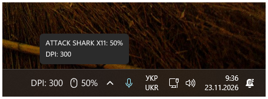

# X11 Battery Tray

A Windows tray utility for the ATTACK SHARK X11 mouse. It displays battery charge and DPI near the taskbar.

- Latest version: **0.8.3**
- [Download X11Battery.exe](https://github.com/makser008-bit/X11Battery/releases/latest)
- Ukrainian guide: [README.txt](README.txt)
- English guide: [README_EN.txt](README_EN.txt)

Run the executable on Windows with the mouse connected through its 2.4 GHz receiver. The source and `build_exe.bat` are included for building from source.

